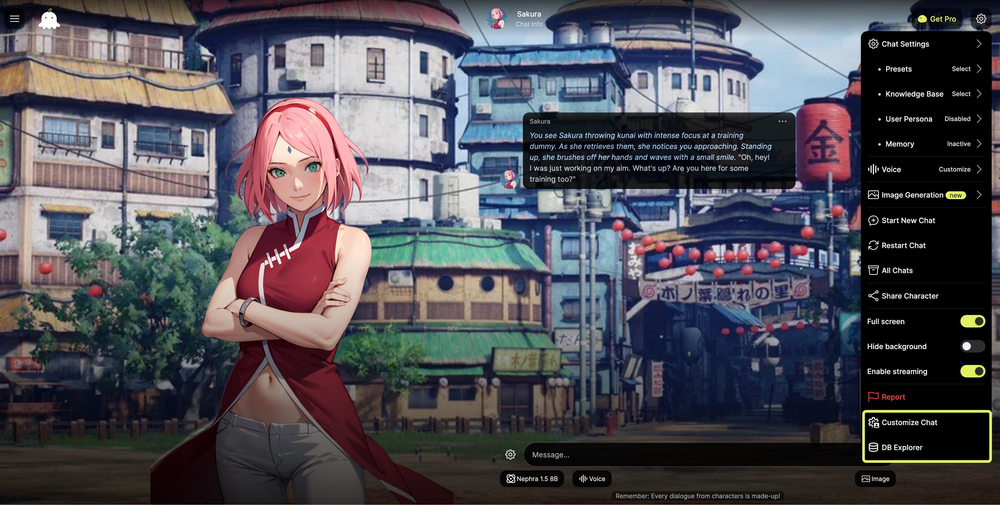
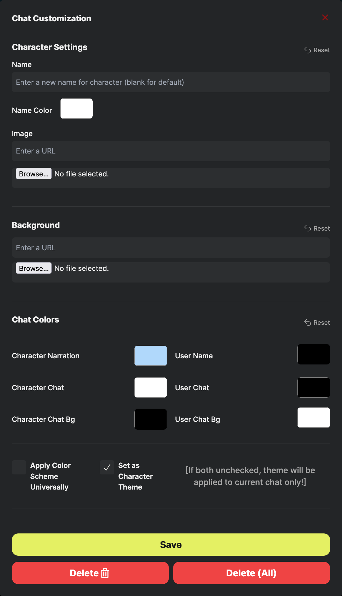
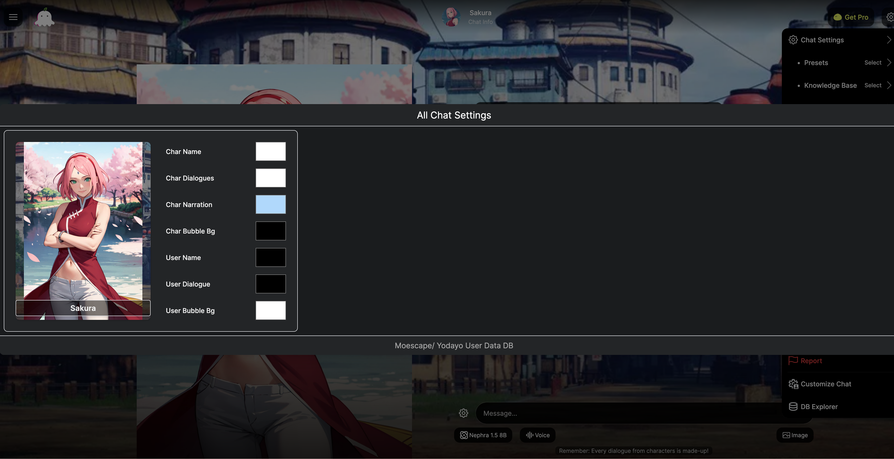

# Yodayo/Moescape-Chat-Customizer

Customize Moescape/Yodayo Tavern chat to your liking with enhanced performance and modern features.

## Overview
Yodayo Chat Customizer is a userscript that allows you to fully customize the appearance and behavior of the Yodayo chat interface. This project has been recently updated with significant performance improvements, better error handling, and enhanced user experience.

## Features
- **Enhanced Performance**: Optimized CSS injection and caching for smoother operation
- **Smart Color Management**: Per-character themes with universal color fallbacks
- **Advanced Image Handling**: Support for both URLs and file uploads with automatic base64 conversion
- **Intelligent Background Capture**: Automatically preserves original backgrounds before customization
- **Real-time Preview**: See changes instantly as you customize
- **Robust Error Handling**: Better stability and graceful error recovery
- **Improved Database Operations**: Batch operations and optimized data persistence
- **Modern UI**: Clean, intuitive interface with better accessibility
- **Group Chats**: Custom names, colors and images for every character, shown side by side; drag and resize each one
- **Automatic Character Cut-outs**: Characters that only have a background are cut out of it with the background-removal API
- Save, delete, and manage chat/character themes
- Image viewer for all stored characters
- Settings persist via local database
- Lightweight and easy to install

## Recent Updates & Improvements
Highlights only; every version is listed in the [changelog](CHANGELOG.md).

### Group Chats (v1.12)
- **Detection**: Group chats are recognised automatically from the character avatars next to the chat title
- **Per-Character Settings**: A separate window with a **Common** tab and one tab per character (name, image, name and chat colors, size)
- **Side-by-Side Images**: All characters are shown next to each other in a wider character area; drag them anywhere, positions are remembered
- **Cut-outs**: Background-only characters are cut out of their backgrounds in parallel, once per chat
- **One API Key**: The Customizer and the right-click **Remove background** script share the ImageTools key

### Performance Enhancements
- **Optimized CSS Operations**: Implemented dynamic stylesheet injection for better performance
- **Smart Caching**: Added stylesheet caching to reduce DOM queries
- **Event Delegation**: Improved form handling with efficient event management
- **Batch Database Operations**: Reduced database calls with batch saving functionality

### Enhanced User Experience
- **Real-time Form Updates**: Changes are now reflected immediately in the interface
- **Intelligent Background Handling**: Automatic capture and preservation of original backgrounds
- **Improved Error Recovery**: Better handling of edge cases and network issues
- **Temporary Data Management**: Smart temporary storage prevents data loss during customization

### Code Quality Improvements
- **Modular Architecture**: Better separation of concerns with clear function responsibilities
- **Enhanced Documentation**: Comprehensive JSDoc comments for better maintainability
- **Consistent Error Handling**: Unified approach to error logging and user feedback
- **Memory Management**: Proper cleanup of event listeners and cached data

## Installation

**Requirements:**
- A userscript manager such as [Tampermonkey](https://www.tampermonkey.net/) or [Violentmonkey](https://violentmonkey.github.io/)

**To install:**
1. Make sure you have a userscript manager extension installed in your browser.
2. Copy and paste the following URL into your browser's address bar:

   ```
   https://github.com/pervertir/Yodayo-Chat-Customizer/raw/refs/heads/main/MoescapeCustomUI.user.js
   ```

3. Your userscript extension will detect the script and prompt you to install it.

## Usage

### Chat Customizer
1. Once installed, use the settings cog (in the top right corner) in your chat to access the added features.

   
   
   *Background image: [View Raw](https://raw.githubusercontent.com/pervertir/Yodayo-Chat-Customizer/main/.github/resources/menu-items.png)*

2. When you click "Customize Chat", you will see the following modal with enhanced features:

   
   
   *Customizer UI: [View Raw](https://raw.githubusercontent.com/pervertir/Yodayo-Chat-Customizer/main/.github/resources/chat-customizer-ui.png)*

3. **Enhanced Features & Improved Workflow:**
   - **Real-time Preview**: See your changes instantly as you customize
   - **Smart Defaults**: The system automatically captures original backgrounds for easy restoration
   - **URL & File Support**: Upload images directly or paste URLs for both backgrounds and character images
   - **Temporary Storage**: Your changes are preserved even if you don't save immediately
   - **Performance Optimized**: Smooth operation with optimized CSS injection and caching

4. You must click **Save** to store your changes in the database. If you don't press save, your changes will not persist the next time you open the chat.
5. **Delete** will remove the Chat ID from the database (removing the settings you saved for the current chat only).
6. **Delete All** will remove the character from the database, which will remove the saved theme for all chats of that character.
7. If you want to change the theme for all chats (not just a specific character), check **Apply Color Scheme Universally**. This will only store the colors, so you can still upload different images per character/chat.
8. **Unchecking** "Set as Character Theme" before saving will save the theme for the current chat only.

### Group Chats
Group chats (two or more character avatars next to the chat title) are detected automatically, and the character list (names and images) is read from the site's own chat data, so characters who haven't spoken yet are included too.

- Every character's full-body image is shown side by side, slightly overlapping, with the main character in front. Characters without one (only a background) are cut out of their background with the background-removal API (the same ImageTools key as the right-click **Remove background** script: the two scripts share it, so it is only entered once), all at the same time; the cut-out is saved for that chat so it is only made once.
- Drag a character's image to move it; its position is remembered for this chat as soon as you let go. Double-click an image to put it back in place.
- Each character's tab has a **Size** slider (30% to 250%) to make that character bigger or smaller in this chat.
- Without a custom background, the chat uses the background of a character that also has a full-body image (a background-only character's background usually shows that character).
- **Customize Chat** opens the group window: a **Common** tab with the shared settings (background, user colors, import/export) and one tab per character for its name, image and colors (name, narration, chat text and chat bubble).
- **Save** stores everything for this group chat. With **Also Save Characters as Their Theme** checked, each character's name, image and colors are also saved to that character's own theme, so they carry over to its other chats.
- **Delete All** removes this chat's settings and the theme of every character in it.
- Settings are stored like any other chat, as extra fields on the chat's record (for example `character_alias@<character id>`), so no database upgrade is needed and exports/imports include them.

### Right-Click Scripts (optional)
Small companion userscripts that add commands to the browser's right-click menu (Tampermonkey submenu) on chat pages. Install each one by opening its URL:

| Script | What it does | Install URL |
|---|---|---|
| Remove background | Cuts the character out of the right-clicked image (or the chat background) and uses it as the character image | `https://github.com/pervertir/Yodayo-Chat-Customizer/raw/refs/heads/main/context-menu/remove-background.user.js` |
| Open character in new tab | Opens the character image (yours or the site's) in a new tab | `https://github.com/pervertir/Yodayo-Chat-Customizer/raw/refs/heads/main/context-menu/open-character.user.js` |
| Open background in new tab | Opens the chat background (yours or the site's) in a new tab | `https://github.com/pervertir/Yodayo-Chat-Customizer/raw/refs/heads/main/context-menu/open-background.user.js` |

Background removal uses the [ImageTools](https://imagetools.top) API. You're asked for your API key the first time it's needed; it is kept in Tampermonkey's storage (never in the code) and shared between the Customizer and the Remove background script, so you only enter it once. If the key is rejected, both forget it and you're asked again.

### Image Viewer
This feature allows you to see all characters stored in your database with an improved interface.



*Image Viewer: [View Raw](https://raw.githubusercontent.com/pervertir/Yodayo-Chat-Customizer/main/.github/resources/image-database.png)*

### Background Image Collection
A collection of about 200 background images (anime and realistic) comes with the customizer. In **Customize Chat**, click **Browse collection** under Background to see previews and apply one with a click; the **Update** button picks up newly added backgrounds.

The image files are in the [`resources/default_backgrounds`](https://github.com/pervertir/Yodayo-Chat-Customizer/tree/feat/universal-bg/resources/default_backgrounds) folder of the `feat/universal-bg` branch (credits in its `CREDITS.md`), if you want to copy a URL or download one.

## Troubleshooting

**Performance Issues:**
- The latest update includes significant performance improvements with CSS caching and optimized operations
- If you experience slowness, try refreshing the page to clear any cached data

**Image Loading Problems:**
- Both URLs and file uploads are now supported with automatic format detection
- If images don't load, check the browser console for error messages

**Settings Not Saving:**
- Ensure you click the **Save** button after making changes
- Check that your browser allows local storage for the Yodayo domain

## FAQ

**Q: Will this break if Yodayo updates?**  
A: The script has been updated with improved error handling and resilience. While some features may still break if the site changes significantly, the latest version is more robust and includes fallback mechanisms. Please open an issue if you notice anything not working.

**Q: Where are my settings stored?**  
A: All settings are stored locally in your browser's IndexedDB. This provides better performance and reliability compared to traditional storage methods. Clearing your browser data will remove your customizations.

**Q: Can I use this on other browsers?**  
A: Yes, as long as your browser supports userscript managers like Tampermonkey or Violentmonkey. The latest updates have improved cross-browser compatibility.

**Q: What's new in the recent updates?**  
A: Major performance improvements, better error handling, real-time preview functionality, enhanced image support (URLs + files), optimized database operations, and improved user experience with temporary data management.

**Q: How do I report issues or suggest features?**  
A: Please open an issue on the GitHub repository with detailed information about the problem or suggestion. Include browser version, userscript manager, and steps to reproduce any issues.

## Contributing
Contributions are welcome! The codebase has been recently refactored for better maintainability and includes comprehensive documentation. Please open an issue or submit a pull request if you have suggestions or improvements.

### Development Notes
- The code now follows modern JavaScript practices with proper error handling
- JSDoc comments provide detailed function documentation
- Performance optimizations are in place for better user experience
- Modular architecture makes it easier to add new features

### Setting Up Git Hooks (Contributors)
This repository uses automated git hooks for semantic versioning. When you clone the repo, you'll need to initialize the git hooks with one command:

```bash
bash .github/setup-git-hooks.sh
```

Once set up, version bumping is automatic:
- `git commit -m 'your message'` → Patch version bump (1.7.4 → 1.7.5)
- `git commit -m '[minor] new feature'` → Minor version bump (1.7.4 → 1.8.0)
- `git commit -m '[major] breaking change'` → Major version bump (1.7.4 → 2.0.0)

The hooks live in `.github/hooks/` and are version-controlled, so they work across all git worktrees. The pre-commit hook does the patch bump; the post-commit hook amends the same commit for `[minor]`/`[major]`. Amends, rebases and cherry-picks are not bumped again, a version you set by hand is kept, and only the version line is touched. See [VERSION_BUMPING.md](VERSION_BUMPING.md) for details.

## Changelog
See [CHANGELOG.md](CHANGELOG.md) for the full history of changes.

## License
This project is licensed under the MIT License. See the [LICENSE](LICENSE) file for details.
